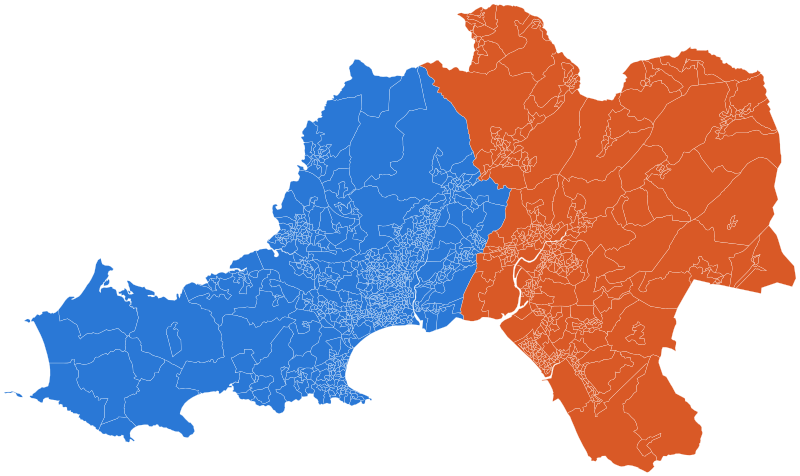
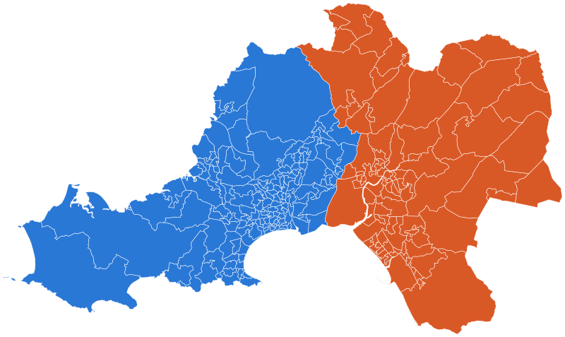
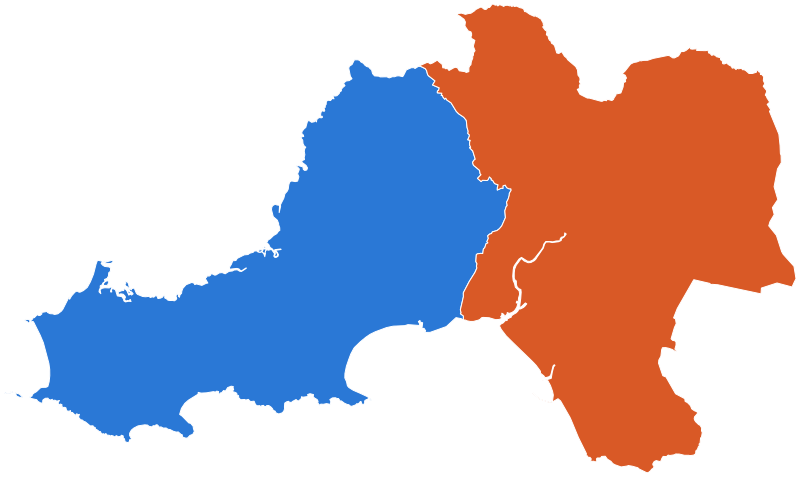

# Power BI shape maps for Swansea and Neath Port Talbot

Ready-to-use map files for the Power BI **Shape map** visual, covering Swansea and Neath Port Talbot.

- **Format:** TopoJSON, saved as `.json`.
- **Levels:** Output Area (OA), Lower layer Super Output Area (LSOA), Middle layer Super Output Area (MSOA) and council outline.
- **Versions:** 2001, 2011 and 2021 census boundaries. The council outline is the May 2026 release.
- **Source:** [ONS Open Geography Portal](https://geoportal.statistics.gov.uk), downloaded on 10/11/2026.

## Previews

Blue is Swansea. Orange is Neath Port Talbot.

| | OA | LSOA | MSOA |
|---|---|---|---|
| **2001** |  |  |  |
| **2011** |  |  |  |
| **2021** |  |  |  |

Council outline:



Every map file has a matching image in [`images/`](images), including the single-council files.

## Pick a file

Each cell links to the map file. The number is how many areas the file holds.

| Level | Version | Swansea | Neath Port Talbot | Both councils |
|---|---|---|---|---|
| OA | 2001 | [759](maps/2001/swansea-oa-2001.json) | [466](maps/2001/neath-port-talbot-oa-2001.json) | [1,225](maps/2001/swansea-and-neath-port-talbot-oa-2001.json) |
| LSOA | 2001 | [147](maps/2001/swansea-lsoa-2001.json) | [91](maps/2001/neath-port-talbot-lsoa-2001.json) | [238](maps/2001/swansea-and-neath-port-talbot-lsoa-2001.json) |
| MSOA | 2001 | [31](maps/2001/swansea-msoa-2001.json) | [19](maps/2001/neath-port-talbot-msoa-2001.json) | [50](maps/2001/swansea-and-neath-port-talbot-msoa-2001.json) |
| OA | 2011 | [792](maps/2011/swansea-oa-2011.json) | [473](maps/2011/neath-port-talbot-oa-2011.json) | [1,265](maps/2011/swansea-and-neath-port-talbot-oa-2011.json) |
| LSOA | 2011 | [148](maps/2011/swansea-lsoa-2011.json) | [91](maps/2011/neath-port-talbot-lsoa-2011.json) | [239](maps/2011/swansea-and-neath-port-talbot-lsoa-2011.json) |
| MSOA | 2011 | [31](maps/2011/swansea-msoa-2011.json) | [19](maps/2011/neath-port-talbot-msoa-2011.json) | [50](maps/2011/swansea-and-neath-port-talbot-msoa-2011.json) |
| OA | 2021 | [806](maps/2021/swansea-oa-2021.json) | [485](maps/2021/neath-port-talbot-oa-2021.json) | [1,291](maps/2021/swansea-and-neath-port-talbot-oa-2021.json) |
| LSOA | 2021 | [150](maps/2021/swansea-lsoa-2021.json) | [90](maps/2021/neath-port-talbot-lsoa-2021.json) | [240](maps/2021/swansea-and-neath-port-talbot-lsoa-2021.json) |
| MSOA | 2021 | [30](maps/2021/swansea-msoa-2021.json) | [18](maps/2021/neath-port-talbot-msoa-2021.json) | [48](maps/2021/swansea-and-neath-port-talbot-msoa-2021.json) |
| Council | 2026 | [1](maps/council/swansea-council-2026.json) | [1](maps/council/neath-port-talbot-council-2026.json) | [2](maps/council/swansea-and-neath-port-talbot-council-2026.json) |

To download one file: open it on GitHub, then select **Download raw file**.

**Use the version that matches your data.** Area codes changed between censuses. 2021 census data needs a 2021 map, 2011 data needs a 2011 map, and so on.

## Use a file in Power BI

You need a table with one row per area and a column holding the area code, for example `W01000736`.

1. In Power BI Desktop, add a **Shape map** visual to the report.
2. Drag your area code column into **Location**.
3. Drag a number, for example population, into **Color saturation**.
4. Select the visual. In the **Visualizations** pane, select **Format visual** and expand **Map settings**.
5. Set **Map type** to **Custom map**.
6. Select **Add a map type** and choose the `.json` file you downloaded.
7. Set **Projection** to **Mercator**. Equirectangular makes the area look stretched sideways at this latitude.
8. Select **View map type key** and check that the codes match your column.

These steps follow Microsoft's guide: [Create shape map visualizations in Power BI](https://learn.microsoft.com/en-us/power-bi/visuals/desktop-shape-map).

### Load by URL instead

Power BI can also read a map straight from a web address, so you do not need to download anything.

1. In **Map settings**, set **Type** to **URL**.
2. Paste the raw address of a file, for example:

   ```text
   https://raw.githubusercontent.com/CodeWithBehnam/map-powerbi/main/maps/2021/swansea-and-neath-port-talbot-lsoa-2021.json
   ```

This route has not been tested from this repository. If it fails, download the file and use the steps above.

## Map keys

Power BI matches your **Location** column against these properties in each file.

| Level | Version | Code | Name | Welsh name |
|---|---|---|---|---|
| OA | 2001 | `OA01CD` | none | none |
| OA | 2011 | `OA11CD` | none | none |
| OA | 2021 | `OA21CD` | none | none |
| LSOA | 2001 | `LSOA01CD` | `LSOA01NM` | `LSOA01NMW` |
| LSOA | 2011 | `LSOA11CD` | `LSOA11NM` | `LSOA11NMW` |
| LSOA | 2021 | `LSOA21CD` | `LSOA21NM` | `LSOA21NMW` |
| MSOA | 2001 | `MSOA01CD` | `MSOA01NM` | `MSOA01NMW` |
| MSOA | 2011 | `MSOA11CD` | `MSOA11NM` | `MSOA11NMW` |
| MSOA | 2021 | `MSOA21CD` | `MSOA21NM` | `MSOA21NMW` |
| Council | 2026 | `LAD26CD` | `LAD26NM` | `LAD26NMW` |

Example values: `W01000736`, `Swansea 028A`, `Abertawe 028A`.

Match on the code where you can. Codes are unique and stable. Output Areas have codes only.

## If something does not work

| Problem | Fix |
|---|---|
| There is no Shape map icon | Go to **File > Options and settings > Options > Preview features**, turn on **Shape map visual** and restart Power BI Desktop. |
| The file picker does not show the file | Rename the file so it ends in `.topojson`. The content stays the same. |
| The map is blank or all one colour | Open **View map type key** and compare the codes with your column. Check that the map version matches your data and that the column type is **Text**. |
| Some areas stay grey | Those codes are missing from your data, or belong to a different version. |
| The map is slow | Use a single-council file, or a higher level such as MSOA. The Shape map visual plots at most 1,500 areas. |

## Rebuild the files

You only need this to refresh the data from ONS. It needs [Bun](https://bun.sh).

```sh
bun install
bun run build          # reuse downloads in .cache/
bun run build:refresh  # download everything again
```

The build downloads each layer from the ONS ArcGIS service, checks the number of areas against the service's own count, and writes `maps/` and `images/` with [mapshaper](https://github.com/mbloch/mapshaper).

To move to a newer ONS release, edit the `service` name in [`scripts/sources.ts`](scripts/sources.ts), then run `bun run build:refresh`.

## Sources

All layers are the ONS "BGC" versions: generalised to 20 m and clipped to the coastline. Each service sits under `https://services1.arcgis.com/ESMARspQHYMw9BZ9/arcgis/rest/services/<service>/FeatureServer`.

| Level | Version | ONS service |
|---|---|---|
| OA | 2001 | `Output_Areas_Dec_2001_Boundaries_EW_BGC_2022` |
| LSOA | 2001 | `Lower_Layer_Super_Output_Areas_Dec_2001_EW_BGC_2022` |
| MSOA | 2001 | `Middle_Layer_Super_Output_Areas_Dec_2001_Boundaries_EW_BGC_2022` |
| OA | 2011 | `Output_Areas_Dec_2011_Boundaries_EW_BGC_2022` |
| LSOA | 2011 | `LSOA_Dec_2011_Boundaries_Generalised_Clipped_BGC_EW_V3` |
| MSOA | 2011 | `MSOA_Dec_2011_Boundaries_Generalised_Clipped_BGC_EW_V3_2022` |
| OA | 2021 | `Output_Areas_2021_EW_BGC_V2` |
| LSOA | 2021 | `Lower_layer_Super_Output_Areas_December_2021_Boundaries_EW_BGC_V5` |
| MSOA | 2021 | `Middle_layer_Super_Output_Areas_December_2021_Boundaries_EW_BGC_V3` |
| Council | 2026 | `Local_Authority_Districts_May_2026_Boundaries_UK_BGC` |

## Licence and attribution

The boundary data is published under the [Open Government Licence v3.0](https://www.nationalarchives.gov.uk/doc/open-government-licence/version/3/). If you publish a map made with these files, include:

> Source: Office for National Statistics licensed under the Open Government Licence v.3.0.
> Contains OS data © Crown copyright and database right 2026.
