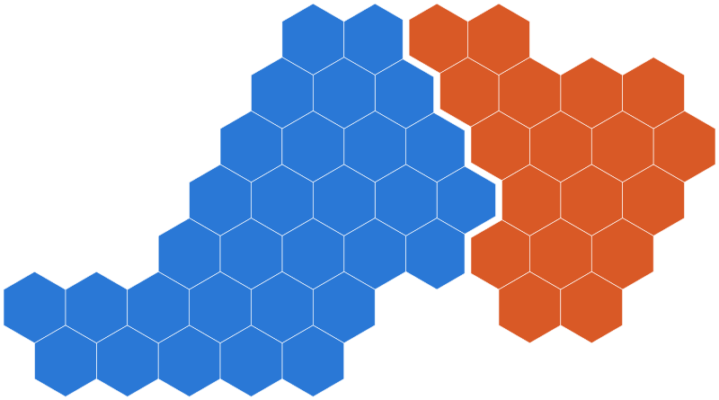
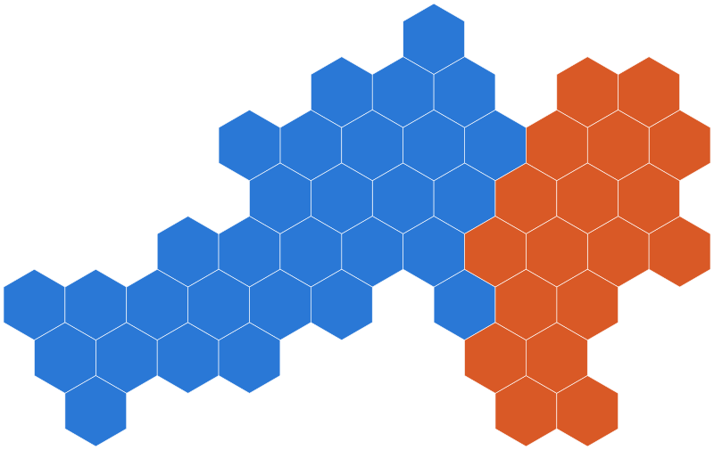
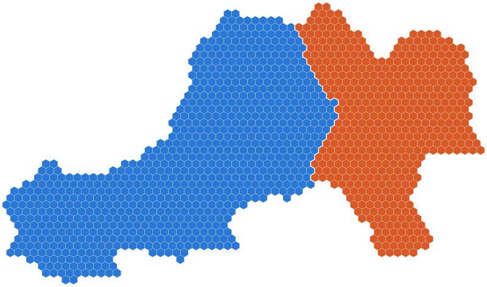
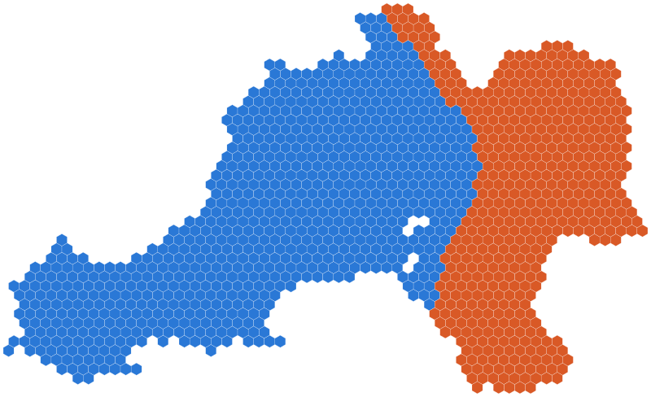

# Power BI shape maps for Swansea and Neath Port Talbot

Ready-to-use map files for the Power BI **Shape map** visual: real boundaries and hex maps, for three census versions.

[](https://github.com/CodeWithBehnam/map-powerbi/actions/workflows/check.yml)
[](https://github.com/CodeWithBehnam/map-powerbi/actions/workflows/pages.yml)
[](https://codewithbehnam.github.io/map-powerbi/)
[](docs/power-bi-guide.md)
[](#pick-a-file)
[](LICENSE)
[](https://www.nationalarchives.gov.uk/doc/open-government-licence/version/3/)

**[Open the live dashboard](https://codewithbehnam.github.io/map-powerbi/)** · [Pick a file](#pick-a-file) · [Use it in Power BI](#use-a-file-in-power-bi) · [Guides](#guides)

[](https://codewithbehnam.github.io/map-powerbi/)

## At a glance

| | |
|---|---|
| **Area** | Swansea, Neath Port Talbot, or both together |
| **Levels** | Output Area (OA), Lower layer Super Output Area (LSOA), Middle layer Super Output Area (MSOA), council outline |
| **Versions** | 2001, 2011 and 2021 census boundaries. The council outline is the May 2026 release. |
| **Map types** | Geographic (real boundaries), hexmap and geogrid (one equal-sized hexagon per area) |
| **Format** | TopoJSON, saved as `.json` |
| **Source** | [ONS Open Geography Portal](https://geoportal.statistics.gov.uk), downloaded on 10/11/2026 |

## Quick start

1. **See it first.** Open the [live dashboard](https://codewithbehnam.github.io/map-powerbi/) and switch between map types.
2. **Pick a file** from the [table below](#pick-a-file) and download it.
3. **Load it** into a Shape map visual by following [Use a file in Power BI](#use-a-file-in-power-bi).

No data yet? Try a map with the [sample data](#sample-data).

## Previews

2021 boundaries. Blue is Swansea. Orange is Neath Port Talbot.

| | Geographic | Hexmap | Geogrid |
|---|---|---|---|
| **MSOA** |  |  |  |
| **LSOA** |  |  |  |
| **OA** |  |  |  |

| Map type | What it shows |
|---|---|
| **Geographic** | The real boundaries. |
| **Hexmap** | One hexagon per area, following the outline of the map. Each council stays in one piece, with a thin gap between them. Made with [hexmap](https://github.com/mitchelloharawild/hexmap). |
| **Geogrid** | One hexagon per area on a regular grid shaped like the whole map. Each council stays in one piece, with no gap between them. Grid made with [geogrid](https://github.com/jbaileyh/geogrid). |

Every map file has a matching image in [`images/`](images).

## Pick a file

Files follow one pattern:

```text
maps/<version>/<level>/<council>/<map type>/<file>.json
```

Each cell links to the map files. The number is the geographic map and shows how many areas it holds.

| Level | Version | Swansea | Neath Port Talbot | Both councils |
|---|---|---|---|---|
| OA | 2001 | [759](maps/2001/oa/swansea/geographic/swansea-oa-2001.json) · [hexmap](maps/2001/oa/swansea/hexmap/swansea-oa-2001-hexmap.json) · [geogrid](maps/2001/oa/swansea/geogrid/swansea-oa-2001-geogrid.json) | [466](maps/2001/oa/neath-port-talbot/geographic/neath-port-talbot-oa-2001.json) · [hexmap](maps/2001/oa/neath-port-talbot/hexmap/neath-port-talbot-oa-2001-hexmap.json) · [geogrid](maps/2001/oa/neath-port-talbot/geogrid/neath-port-talbot-oa-2001-geogrid.json) | [1,225](maps/2001/oa/swansea-and-neath-port-talbot/geographic/swansea-and-neath-port-talbot-oa-2001.json) · [hexmap](maps/2001/oa/swansea-and-neath-port-talbot/hexmap/swansea-and-neath-port-talbot-oa-2001-hexmap.json) · [geogrid](maps/2001/oa/swansea-and-neath-port-talbot/geogrid/swansea-and-neath-port-talbot-oa-2001-geogrid.json) |
| LSOA | 2001 | [147](maps/2001/lsoa/swansea/geographic/swansea-lsoa-2001.json) · [hexmap](maps/2001/lsoa/swansea/hexmap/swansea-lsoa-2001-hexmap.json) · [geogrid](maps/2001/lsoa/swansea/geogrid/swansea-lsoa-2001-geogrid.json) | [91](maps/2001/lsoa/neath-port-talbot/geographic/neath-port-talbot-lsoa-2001.json) · [hexmap](maps/2001/lsoa/neath-port-talbot/hexmap/neath-port-talbot-lsoa-2001-hexmap.json) · [geogrid](maps/2001/lsoa/neath-port-talbot/geogrid/neath-port-talbot-lsoa-2001-geogrid.json) | [238](maps/2001/lsoa/swansea-and-neath-port-talbot/geographic/swansea-and-neath-port-talbot-lsoa-2001.json) · [hexmap](maps/2001/lsoa/swansea-and-neath-port-talbot/hexmap/swansea-and-neath-port-talbot-lsoa-2001-hexmap.json) · [geogrid](maps/2001/lsoa/swansea-and-neath-port-talbot/geogrid/swansea-and-neath-port-talbot-lsoa-2001-geogrid.json) |
| MSOA | 2001 | [31](maps/2001/msoa/swansea/geographic/swansea-msoa-2001.json) · [hexmap](maps/2001/msoa/swansea/hexmap/swansea-msoa-2001-hexmap.json) · [geogrid](maps/2001/msoa/swansea/geogrid/swansea-msoa-2001-geogrid.json) | [19](maps/2001/msoa/neath-port-talbot/geographic/neath-port-talbot-msoa-2001.json) · [hexmap](maps/2001/msoa/neath-port-talbot/hexmap/neath-port-talbot-msoa-2001-hexmap.json) · [geogrid](maps/2001/msoa/neath-port-talbot/geogrid/neath-port-talbot-msoa-2001-geogrid.json) | [50](maps/2001/msoa/swansea-and-neath-port-talbot/geographic/swansea-and-neath-port-talbot-msoa-2001.json) · [hexmap](maps/2001/msoa/swansea-and-neath-port-talbot/hexmap/swansea-and-neath-port-talbot-msoa-2001-hexmap.json) · [geogrid](maps/2001/msoa/swansea-and-neath-port-talbot/geogrid/swansea-and-neath-port-talbot-msoa-2001-geogrid.json) |
| OA | 2011 | [792](maps/2011/oa/swansea/geographic/swansea-oa-2011.json) · [hexmap](maps/2011/oa/swansea/hexmap/swansea-oa-2011-hexmap.json) · [geogrid](maps/2011/oa/swansea/geogrid/swansea-oa-2011-geogrid.json) | [473](maps/2011/oa/neath-port-talbot/geographic/neath-port-talbot-oa-2011.json) · [hexmap](maps/2011/oa/neath-port-talbot/hexmap/neath-port-talbot-oa-2011-hexmap.json) · [geogrid](maps/2011/oa/neath-port-talbot/geogrid/neath-port-talbot-oa-2011-geogrid.json) | [1,265](maps/2011/oa/swansea-and-neath-port-talbot/geographic/swansea-and-neath-port-talbot-oa-2011.json) · [hexmap](maps/2011/oa/swansea-and-neath-port-talbot/hexmap/swansea-and-neath-port-talbot-oa-2011-hexmap.json) · [geogrid](maps/2011/oa/swansea-and-neath-port-talbot/geogrid/swansea-and-neath-port-talbot-oa-2011-geogrid.json) |
| LSOA | 2011 | [148](maps/2011/lsoa/swansea/geographic/swansea-lsoa-2011.json) · [hexmap](maps/2011/lsoa/swansea/hexmap/swansea-lsoa-2011-hexmap.json) · [geogrid](maps/2011/lsoa/swansea/geogrid/swansea-lsoa-2011-geogrid.json) | [91](maps/2011/lsoa/neath-port-talbot/geographic/neath-port-talbot-lsoa-2011.json) · [hexmap](maps/2011/lsoa/neath-port-talbot/hexmap/neath-port-talbot-lsoa-2011-hexmap.json) · [geogrid](maps/2011/lsoa/neath-port-talbot/geogrid/neath-port-talbot-lsoa-2011-geogrid.json) | [239](maps/2011/lsoa/swansea-and-neath-port-talbot/geographic/swansea-and-neath-port-talbot-lsoa-2011.json) · [hexmap](maps/2011/lsoa/swansea-and-neath-port-talbot/hexmap/swansea-and-neath-port-talbot-lsoa-2011-hexmap.json) · [geogrid](maps/2011/lsoa/swansea-and-neath-port-talbot/geogrid/swansea-and-neath-port-talbot-lsoa-2011-geogrid.json) |
| MSOA | 2011 | [31](maps/2011/msoa/swansea/geographic/swansea-msoa-2011.json) · [hexmap](maps/2011/msoa/swansea/hexmap/swansea-msoa-2011-hexmap.json) · [geogrid](maps/2011/msoa/swansea/geogrid/swansea-msoa-2011-geogrid.json) | [19](maps/2011/msoa/neath-port-talbot/geographic/neath-port-talbot-msoa-2011.json) · [hexmap](maps/2011/msoa/neath-port-talbot/hexmap/neath-port-talbot-msoa-2011-hexmap.json) · [geogrid](maps/2011/msoa/neath-port-talbot/geogrid/neath-port-talbot-msoa-2011-geogrid.json) | [50](maps/2011/msoa/swansea-and-neath-port-talbot/geographic/swansea-and-neath-port-talbot-msoa-2011.json) · [hexmap](maps/2011/msoa/swansea-and-neath-port-talbot/hexmap/swansea-and-neath-port-talbot-msoa-2011-hexmap.json) · [geogrid](maps/2011/msoa/swansea-and-neath-port-talbot/geogrid/swansea-and-neath-port-talbot-msoa-2011-geogrid.json) |
| OA | 2021 | [806](maps/2021/oa/swansea/geographic/swansea-oa-2021.json) · [hexmap](maps/2021/oa/swansea/hexmap/swansea-oa-2021-hexmap.json) · [geogrid](maps/2021/oa/swansea/geogrid/swansea-oa-2021-geogrid.json) | [485](maps/2021/oa/neath-port-talbot/geographic/neath-port-talbot-oa-2021.json) · [hexmap](maps/2021/oa/neath-port-talbot/hexmap/neath-port-talbot-oa-2021-hexmap.json) · [geogrid](maps/2021/oa/neath-port-talbot/geogrid/neath-port-talbot-oa-2021-geogrid.json) | [1,291](maps/2021/oa/swansea-and-neath-port-talbot/geographic/swansea-and-neath-port-talbot-oa-2021.json) · [hexmap](maps/2021/oa/swansea-and-neath-port-talbot/hexmap/swansea-and-neath-port-talbot-oa-2021-hexmap.json) · [geogrid](maps/2021/oa/swansea-and-neath-port-talbot/geogrid/swansea-and-neath-port-talbot-oa-2021-geogrid.json) |
| LSOA | 2021 | [150](maps/2021/lsoa/swansea/geographic/swansea-lsoa-2021.json) · [hexmap](maps/2021/lsoa/swansea/hexmap/swansea-lsoa-2021-hexmap.json) · [geogrid](maps/2021/lsoa/swansea/geogrid/swansea-lsoa-2021-geogrid.json) | [90](maps/2021/lsoa/neath-port-talbot/geographic/neath-port-talbot-lsoa-2021.json) · [hexmap](maps/2021/lsoa/neath-port-talbot/hexmap/neath-port-talbot-lsoa-2021-hexmap.json) · [geogrid](maps/2021/lsoa/neath-port-talbot/geogrid/neath-port-talbot-lsoa-2021-geogrid.json) | [240](maps/2021/lsoa/swansea-and-neath-port-talbot/geographic/swansea-and-neath-port-talbot-lsoa-2021.json) · [hexmap](maps/2021/lsoa/swansea-and-neath-port-talbot/hexmap/swansea-and-neath-port-talbot-lsoa-2021-hexmap.json) · [geogrid](maps/2021/lsoa/swansea-and-neath-port-talbot/geogrid/swansea-and-neath-port-talbot-lsoa-2021-geogrid.json) |
| MSOA | 2021 | [30](maps/2021/msoa/swansea/geographic/swansea-msoa-2021.json) · [hexmap](maps/2021/msoa/swansea/hexmap/swansea-msoa-2021-hexmap.json) · [geogrid](maps/2021/msoa/swansea/geogrid/swansea-msoa-2021-geogrid.json) | [18](maps/2021/msoa/neath-port-talbot/geographic/neath-port-talbot-msoa-2021.json) · [hexmap](maps/2021/msoa/neath-port-talbot/hexmap/neath-port-talbot-msoa-2021-hexmap.json) · [geogrid](maps/2021/msoa/neath-port-talbot/geogrid/neath-port-talbot-msoa-2021-geogrid.json) | [48](maps/2021/msoa/swansea-and-neath-port-talbot/geographic/swansea-and-neath-port-talbot-msoa-2021.json) · [hexmap](maps/2021/msoa/swansea-and-neath-port-talbot/hexmap/swansea-and-neath-port-talbot-msoa-2021-hexmap.json) · [geogrid](maps/2021/msoa/swansea-and-neath-port-talbot/geogrid/swansea-and-neath-port-talbot-msoa-2021-geogrid.json) |
| Council | 2026 | [1](maps/2026/council/swansea/geographic/swansea-council-2026.json) | [1](maps/2026/council/neath-port-talbot/geographic/neath-port-talbot-council-2026.json) | [2](maps/2026/council/swansea-and-neath-port-talbot/geographic/swansea-and-neath-port-talbot-council-2026.json) |


To download one file, open it on GitHub and select **Download raw file**.

**Use the version that matches your data.** Area codes changed between censuses. 2021 census data needs a 2021 map, 2011 data needs a 2011 map, and so on.

## Use a file in Power BI

You need a table with one row per area and a column holding the area code, for example `W01000736`.

1. In Power BI Desktop, add a **Shape map** visual to the report.
2. Drag your area code column into **Location**.
3. Drag a number, for example population, into **Color saturation**.
4. Select the visual. In the **Visualizations** pane, select **Format visual** and expand **Map settings**.
5. Set **Map type** to **Custom map**.
6. Select **Add a map type** and choose the `.json` file you downloaded.
7. Set **Projection** to **Mercator**.
8. Select **View map type key** and check that the codes match your column.

The full guide covers map keys, loading by URL and fixes for common problems: [Use the maps in Power BI](docs/power-bi-guide.md).

## Sample data

[`data/synthetic/`](data/synthetic) holds one CSV per level and version, for example [`synthetic-lsoa-2021.csv`](data/synthetic/synthetic-lsoa-2021.csv). Each has the area code, the council and three measures.

**The numbers are made up.** They are not real statistics. Use them to try a map before you connect your own data.

## Guides

| Guide | Read it when |
|---|---|
| [Use the maps in Power BI](docs/power-bi-guide.md) | You want to load a map and colour it with data. |
| [What a map file needs](docs/map-requirements.md) | A map will not load, or you are checking a file from elsewhere. |
| [How to use mapshaper](docs/mapshaper-guide.md) | You are new to mapshaper, the tool that builds these files. |
| [mapshaper cheat sheet](docs/mapshaper-cheat-sheet.md) | You know mapshaper and need a command. |
| [Prepare your own map](docs/your-own-map.md) | You have your own JSON map and want it ready for Power BI, as a hexmap or as a geogrid. |

## Rebuild the files

Most people can skip this section. You only need it to refresh the data from ONS or change how the maps are made. It needs [Bun](https://bun.sh). The hex maps also need R with four packages: see [Install the R packages](docs/your-own-map.md#install-the-r-packages).

```sh
bun install
bun run build          # rebuild maps/ and images/, reusing .cache/
bun run build:rehex    # also compute the hexagons again (slow)
bun run build:refresh  # download from ONS again and rebuild everything
bun run data           # rewrite the synthetic sample data
bun run check          # validate every map, image and sample file
bun run site:serve     # build the dashboard and serve it locally
```

The build downloads each layer from the ONS ArcGIS service, checks the number of areas against the service's own count, computes the hexagons with R, and writes `maps/` and `images/` with [mapshaper](https://github.com/mbloch/mapshaper).

To move to a newer ONS release, edit the `service` name in [`scripts/sources.ts`](scripts/sources.ts), then run `bun run build:refresh`.

## Sources

All layers are the ONS "BGC" versions: generalised to 20 m and clipped to the coastline.

<details>
<summary>Show the ONS service behind each level and version</summary>

Each service sits under `https://services1.arcgis.com/ESMARspQHYMw9BZ9/arcgis/rest/services/<service>/FeatureServer`.

| Level | Version | ONS service |
|---|---|---|
| OA | 2001 | `Output_Areas_Dec_2001_Boundaries_EW_BGC_2022` |
| LSOA | 2001 | `Lower_Layer_Super_Output_Areas_Dec_2001_EW_BGC_2022` |
| MSOA | 2001 | `Middle_Layer_Super_Output_Areas_Dec_2001_Boundaries_EW_BGC_2022` |
| OA | 2011 | `Output_Areas_Dec_2011_Boundaries_EW_BGC_2022` |
| LSOA | 2011 | `LSOA_Dec_2011_Boundaries_Generalised_Clipped_BGC_EW_V3` |
| MSOA | 2011 | `MSOA_Dec_2011_Boundaries_Generalised_Clipped_BGC_EW_V3_2022` |
| OA | 2021 | `Output_Areas_2021_EW_BGC_V2` |
| LSOA | 2021 | `Lower_layer_Super_Output_Areas_December_2021_Boundaries_EW_BGC_V5` |
| MSOA | 2021 | `Middle_layer_Super_Output_Areas_December_2021_Boundaries_EW_BGC_V3` |
| Council | 2026 | `Local_Authority_Districts_May_2026_Boundaries_UK_BGC` |

</details>

## Contributing

Issues and pull requests are welcome. See [CONTRIBUTING.md](CONTRIBUTING.md).

## Licence and attribution

The code and guides are under the [MIT licence](LICENSE).

The boundary data is published under the [Open Government Licence v3.0](https://www.nationalarchives.gov.uk/doc/open-government-licence/version/3/). If you publish a map made with these files, include:

> Source: Office for National Statistics licensed under the Open Government Licence v.3.0.
> Contains OS data © Crown copyright and database right 2026.
