# Power BI shape maps for Wales and the UK

Ready-to-use map files for the Power BI **Shape map** visual: real boundaries and hex maps, from Output Areas in Swansea to councils across the UK.

[](https://github.com/BehnamEbrahimiSBUHB/map-powerbi/actions/workflows/check.yml)
[](https://github.com/BehnamEbrahimiSBUHB/map-powerbi/actions/workflows/pages.yml)
[](https://BehnamEbrahimiSBUHB.github.io/map-powerbi/)
[](docs/power-bi-guide.md)
[](docs/map-files.md)
[](LICENSE)
[](https://www.nationalarchives.gov.uk/doc/open-government-licence/version/3/)

**[Open the live dashboard](https://codewithbehnam.github.io/map-powerbi/)** · [Pick a file](#pick-a-file) · [Use it in Power BI](#use-a-file-in-power-bi) · [Guides](#guides)

[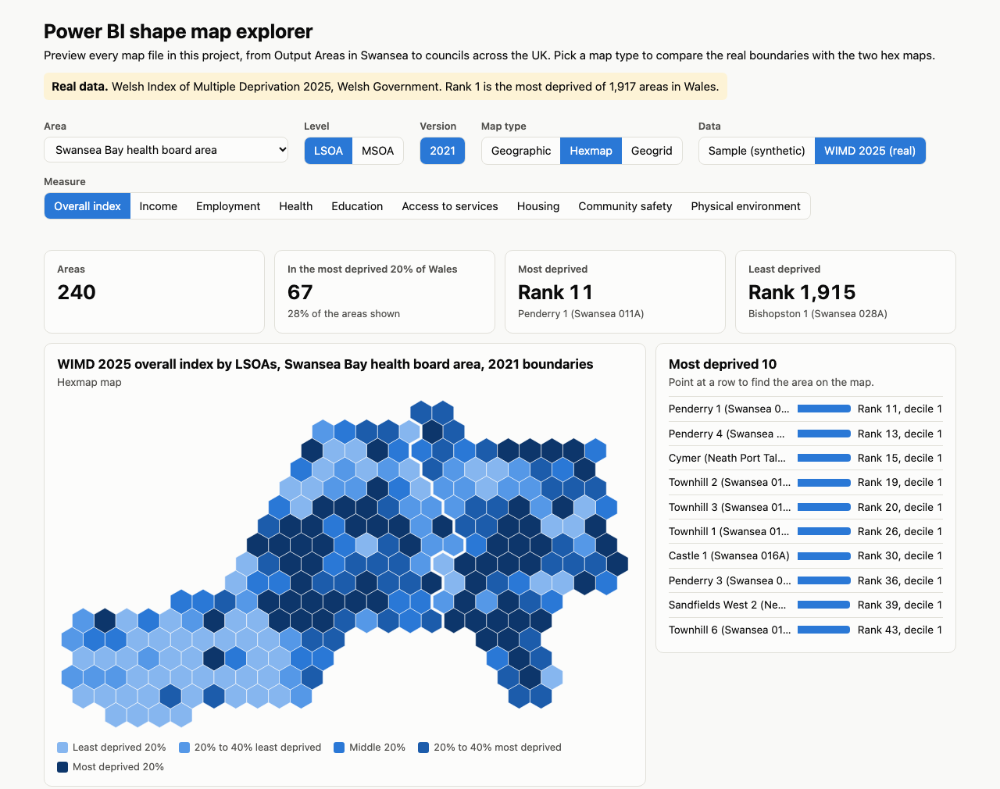](https://BehnamEbrahimiSBUHB.github.io/map-powerbi/)

## At a glance

| | |
|---|---|
| **Areas** | Swansea and Neath Port Talbot, each Welsh health board area, all of Wales, England and Wales, Scotland, Northern Ireland |
| **Levels** | Output Area (OA), LSOA, MSOA, council, health board, primary care cluster |
| **Versions** | Census boundaries for 2001, 2011 and 2021. Councils for 2011, 2021 and 2026. Health boards for 2023. Clusters for 2019 and 2024. |
| **Map types** | Geographic (real boundaries), hexmap and geogrid (one equal-sized hexagon per area) |
| **Data** | Synthetic sample data for every map, and the real Welsh Index of Multiple Deprivation (WIMD) 2025 |
| **Format** | TopoJSON, saved as `.json` |
| **Sources** | [ONS Open Geography Portal](https://geoportal.statistics.gov.uk) and [DataMapWales](https://datamap.gov.wales), downloaded on 10/11/2026 |

## Quick start

1. **See it first.** Open the [live dashboard](https://codewithbehnam.github.io/map-powerbi/) and switch between areas and map types.
2. **Pick a file** from the [catalogue](docs/map-files.md) and download it.
3. **Load it** into a Shape map visual by following [Use a file in Power BI](#use-a-file-in-power-bi).

No data yet? Try a map with the [sample data](#data).

## Previews

Each colour is one group that the hex maps keep together: a council, a health board or a nation.

| | Geographic | Hexmap | Geogrid |
|---|---|---|---|
| **Swansea and Neath Port Talbot, LSOA 2021** |  | 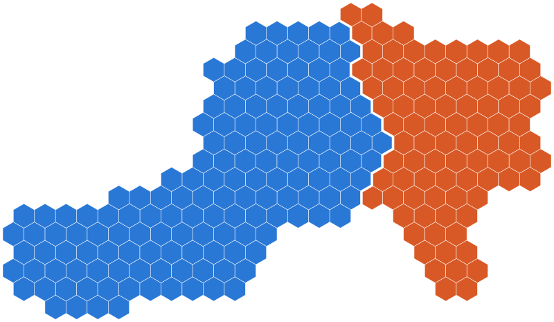 | 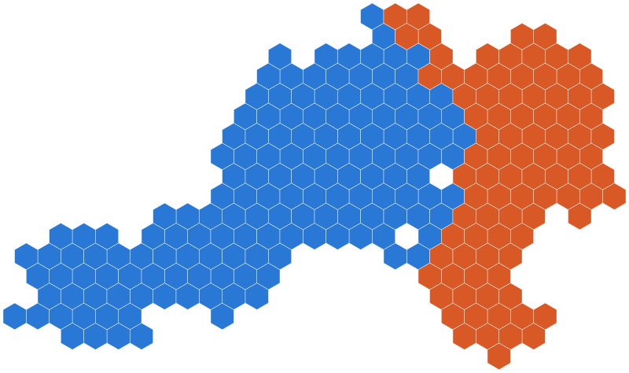 |
| **Betsi Cadwaladr health board area, LSOA 2021** | 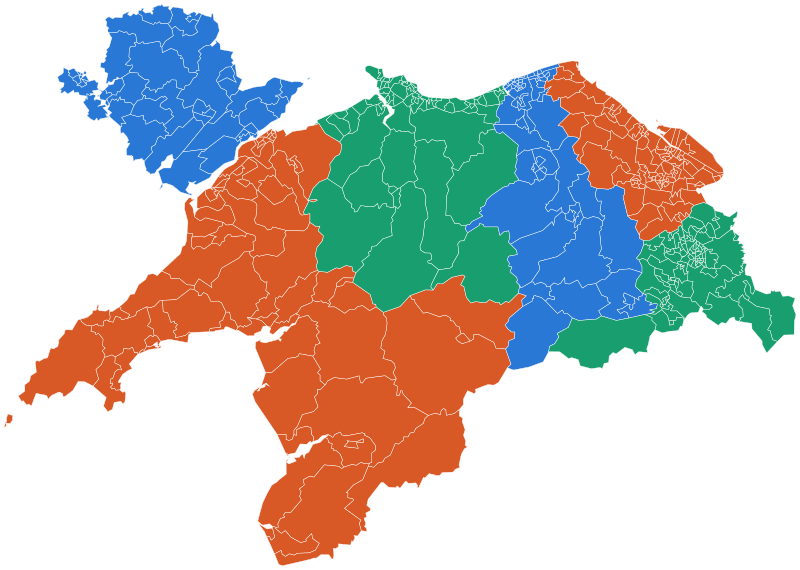 | 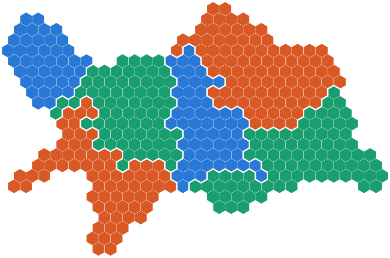 | 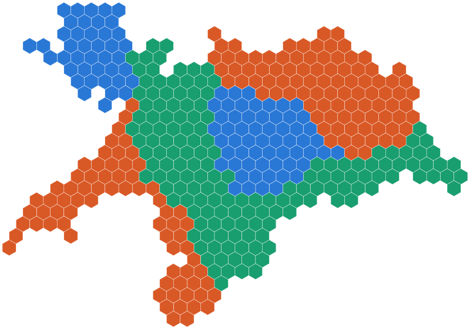 |
| **Wales, MSOA 2021, by health board** | 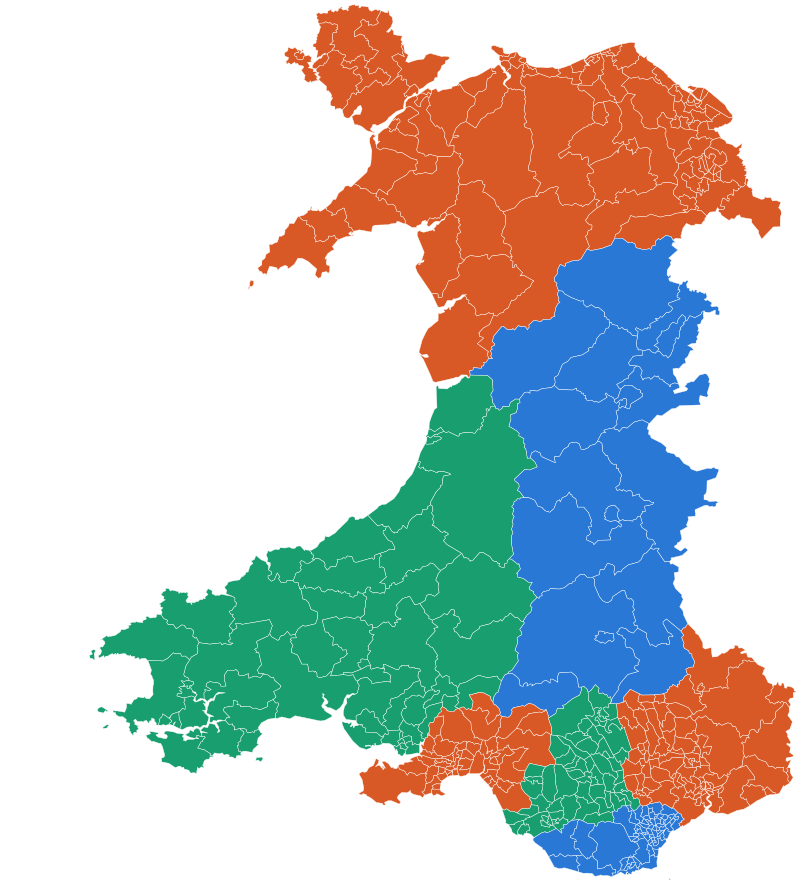 | 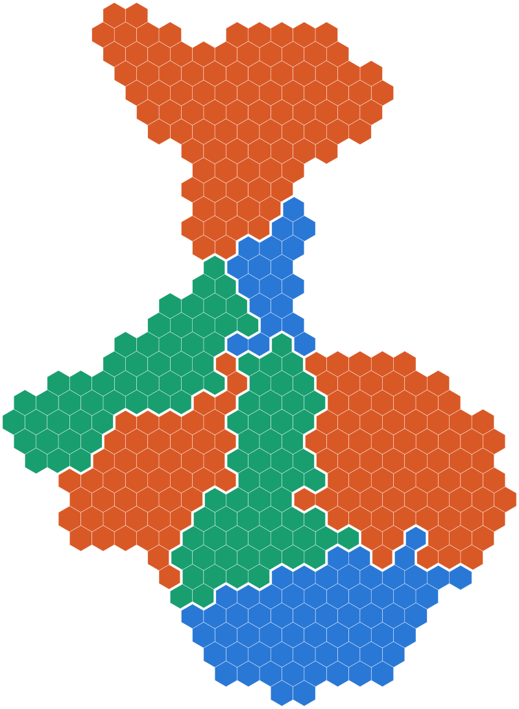 | 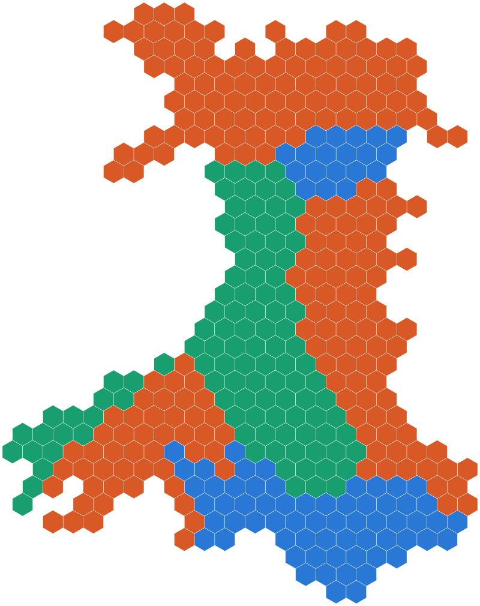 |
| **Wales, primary care clusters 2024** | 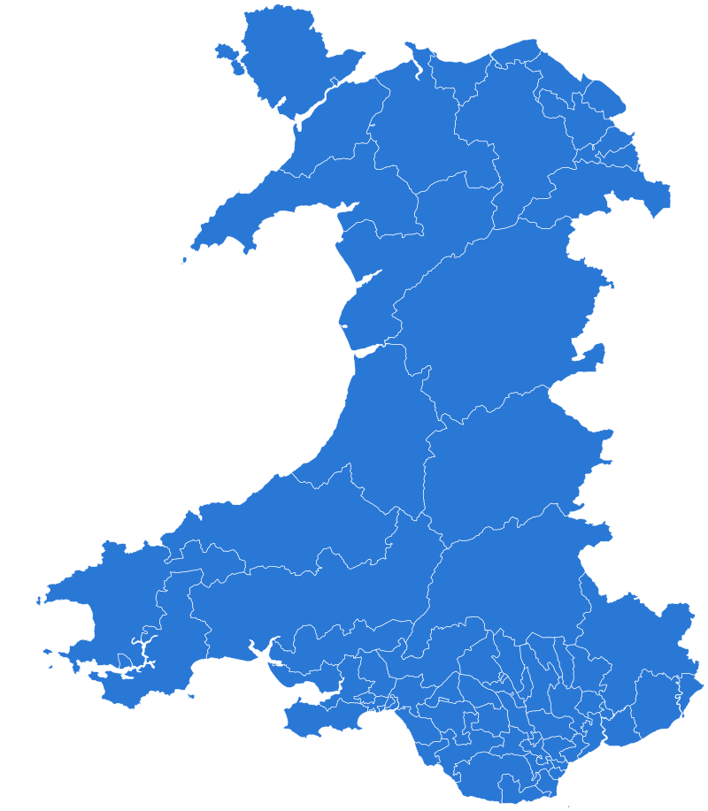 |  |  |
| **England and Wales, councils 2026** | 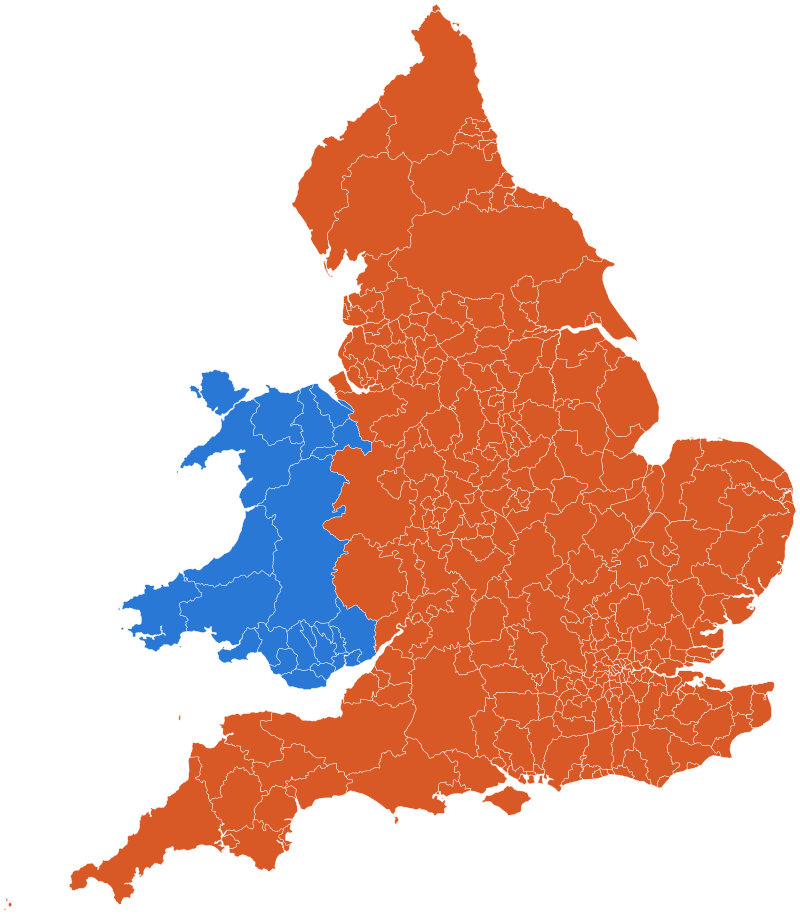 | 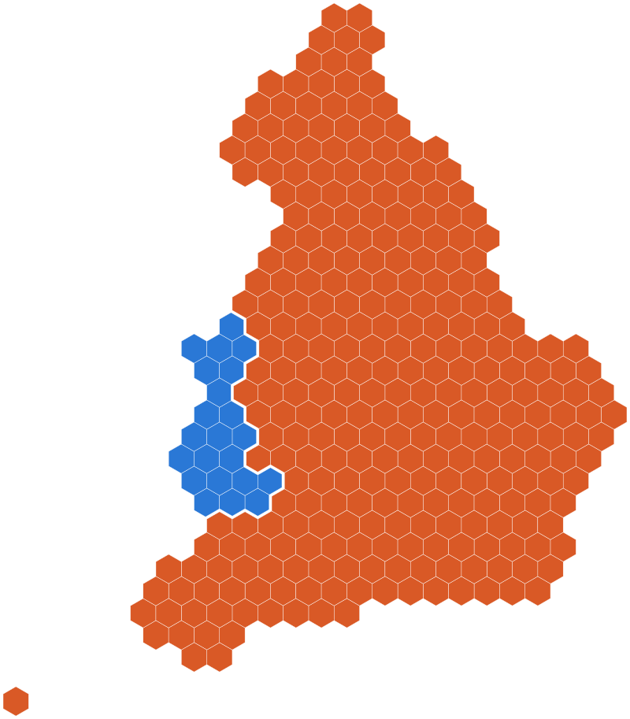 | 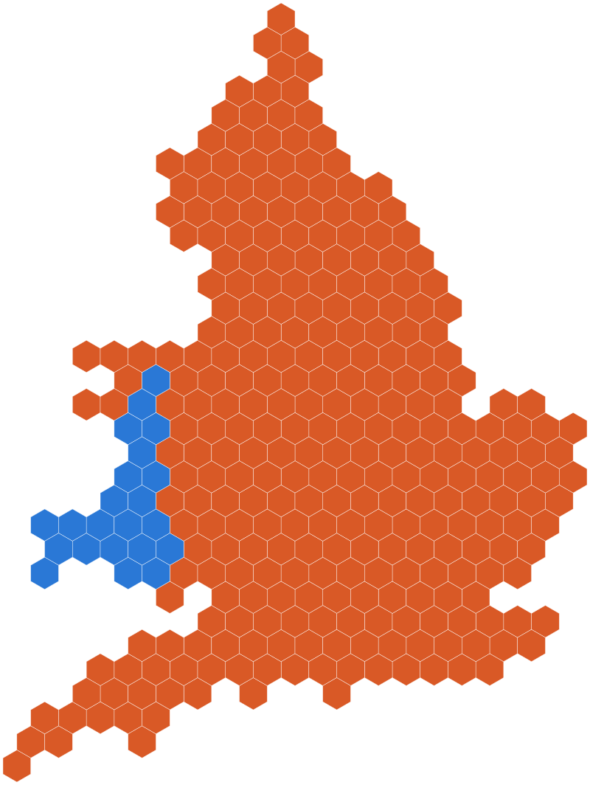 |

| Map type | What it shows |
|---|---|
| **Geographic** | The real boundaries. |
| **Hexmap** | One hexagon per area, following the outline of the map. Each group stays in one piece, with a thin gap between groups. Made with [hexmap](https://github.com/mitchelloharawild/hexmap). |
| **Geogrid** | One hexagon per area on a regular grid shaped like the whole map. Each group stays in one piece, with no gap between groups. Grid made with [geogrid](https://github.com/jbaileyh/geogrid). |

Every map file has a matching image in [`images/`](images).

## Pick a file

Files follow one pattern:

```text
maps/<version>/<level>/<area>/<map type>/<file>.json
```

The **[catalogue](docs/map-files.md)** lists all 180 files with links and shape counts. This table shows what exists.

| Shapes | Areas covered | Versions | Shapes per file |
|---|---|---|---|
| OA, LSOA, MSOA | Swansea, Neath Port Talbot, both together | 2001, 2011, 2021 | 18 to 1,291 |
| Council outline | Swansea, Neath Port Talbot, both together | 2026 | 1 to 2 |
| LSOA, MSOA | Each of the 7 Welsh health board areas | 2021 | 19 to 417 |
| LSOA, MSOA | All of Wales | 2021 | 408 and 1,917 |
| Councils | Wales, England and Wales, Scotland | 2011, 2021, 2026 | 22 to 348 |
| Councils | Northern Ireland | 2021, 2026 | 11 |
| Health boards | Wales | 2023 | 7 |
| Primary care clusters | Wales | 2019, 2024 | 64 and 63 |
| Primary care clusters | Swansea Bay health board area | 2019, 2024 | 8 |

**The all-Wales LSOA file has 1,917 shapes, more than the 1,500 that Power BI plots.** For LSOA maps in Power BI, use a health board file instead. Every other file fits.

**Use the version that matches your data.** Area codes changed between censuses. 2021 census data needs a 2021 map, 2011 data needs a 2011 map, and so on.

## Use a file in Power BI

You need a table with one row per area and a column holding the area code, for example `W01000736`.

1. In Power BI Desktop, add a **Shape map** visual to the report.
2. Drag your area code column into **Location**.
3. Drag a number, for example population, into **Color saturation**.
4. Select the visual. In the **Visualizations** pane, select **Format visual** and expand **Map settings**.
5. Set **Map type** to **Custom map**.
6. Select **Add a map type** and choose the `.json` file you downloaded.
7. Set **Projection** to **Mercator**.
8. Select **View map type key** and check that the codes match your column.

The full guide covers map keys, WIMD, loading by URL and fixes for common problems: [Use the maps in Power BI](docs/power-bi-guide.md).

## Data

| Folder | What it holds | Real? |
|---|---|---|
| [`data/synthetic/`](data/synthetic) | One CSV per level and version, for example [`synthetic-lsoa-2021.csv`](data/synthetic/synthetic-lsoa-2021.csv). Area code, name, parent area and three measures. | **No. The numbers are made up.** Use them to try a map. |
| [`data/wimd/`](data/wimd) | [`wimd-2025-lsoa.csv`](data/wimd/wimd-2025-lsoa.csv): the Welsh Index of Multiple Deprivation 2025. Rank, decile and quintile for the overall index and its 8 domains, for all 1,917 LSOAs in Wales. | Yes. Published by the Welsh Government. |

WIMD 2025 uses 2021 LSOA codes, so it joins to any 2021 LSOA map here. Rank 1 is the most deprived area.

## Guides

| Guide | Read it when |
|---|---|
| [Use the maps in Power BI](docs/power-bi-guide.md) | You want to load a map and colour it with data. |
| [Map files](docs/map-files.md) | You want the full list of files, with links. |
| [What a map file needs](docs/map-requirements.md) | A map will not load, or you are checking a file from elsewhere. |
| [How to use mapshaper](docs/mapshaper-guide.md) | You are new to mapshaper, the tool that builds these files. |
| [mapshaper cheat sheet](docs/mapshaper-cheat-sheet.md) | You know mapshaper and need a command. |
| [Prepare your own map](docs/your-own-map.md) | You have your own JSON map and want it ready for Power BI, as a hexmap or as a geogrid. |

## Rebuild the files

Most people can skip this section. You only need it to refresh the data or change how the maps are made. It needs [Bun](https://bun.sh). The hex maps also need R with four packages: see [Install the R packages](docs/your-own-map.md#install-the-r-packages).

```sh
bun install
bun run build          # rebuild maps/ and images/, reusing .cache/
bun run build:rehex    # also compute the hexagons again (slow)
bun run build:refresh  # download everything again and rebuild
bun run data           # rewrite the synthetic sample data
bun run wimd           # download WIMD 2025 again
bun run catalogue      # rewrite docs/map-files.md
bun run check          # validate every map, image and data file
bun run site:serve     # build the dashboard and serve it locally
```

The build downloads each layer, checks the number of areas against the provider's own count, computes the hexagons with R, and writes `maps/` and `images/` with [mapshaper](https://github.com/mbloch/mapshaper). What to build is set in [`scripts/sources.ts`](scripts/sources.ts).

## Sources

The [catalogue](docs/map-files.md#where-the-boundaries-come-from) names the layer behind every level and version.

| Publisher | Used for |
|---|---|
| [ONS Open Geography Portal](https://geoportal.statistics.gov.uk) | Census areas, councils and health boards |
| [DataMapWales](https://datamap.gov.wales), Welsh Government | Primary care clusters and WIMD 2025 |

**ONS withdrew some layers on 10/11/2026.** That day ONS stopped public access to the detailed (20 m) census boundary layers this project first used. The Swansea and Neath Port Talbot files built from them are unchanged, but they cannot be downloaded again until ONS restores access. The all-Wales and health board files use the ONS 200 m layers, which remain public.

## Contributing

Issues and pull requests are welcome. See [CONTRIBUTING.md](CONTRIBUTING.md).

## Licence and attribution

The code and guides are under the [MIT licence](LICENSE).

The boundary data and WIMD 2025 are published under the [Open Government Licence v3.0](https://www.nationalarchives.gov.uk/doc/open-government-licence/version/3/). If you publish a map made with these files, include:

> Source: Office for National Statistics licensed under the Open Government Licence v.3.0.
> Contains OS data © Crown copyright and database right 2026.

For primary care clusters or WIMD 2025, also include:

> Contains Welsh Government data licensed under the Open Government Licence v.3.0.
